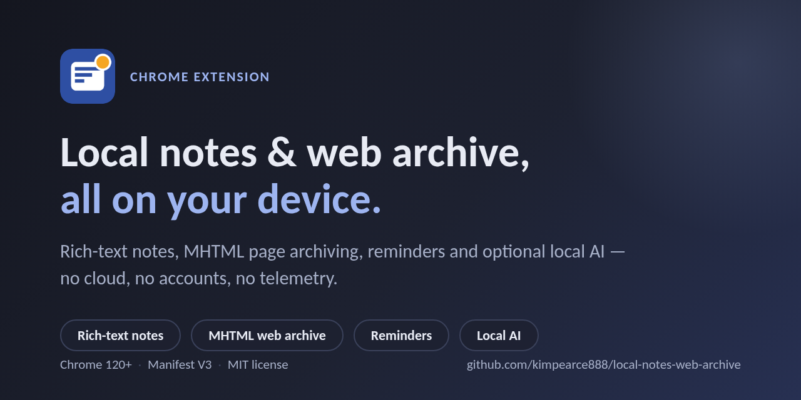
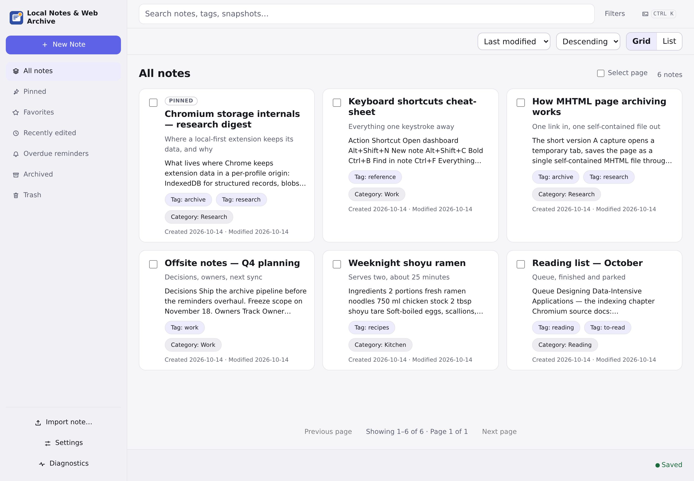
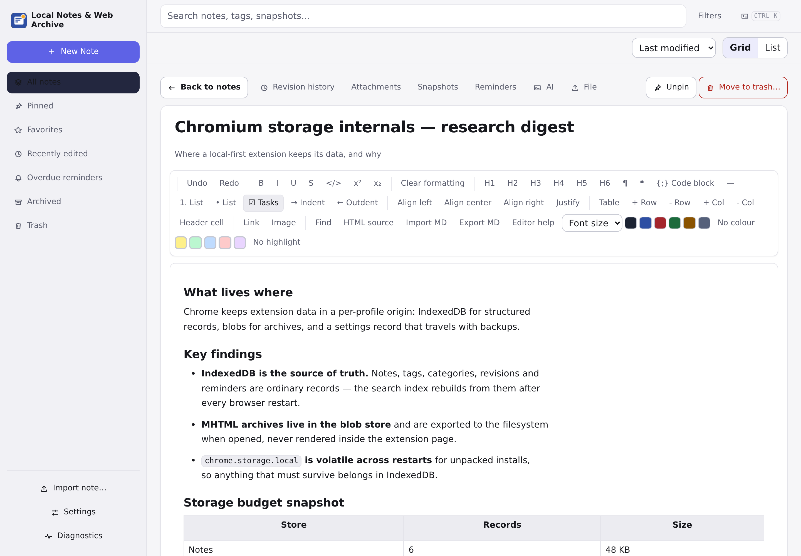
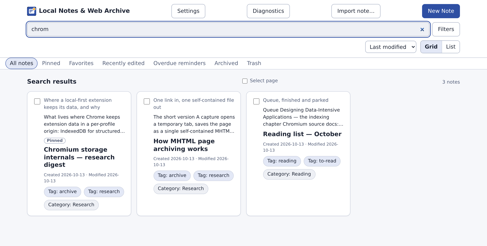
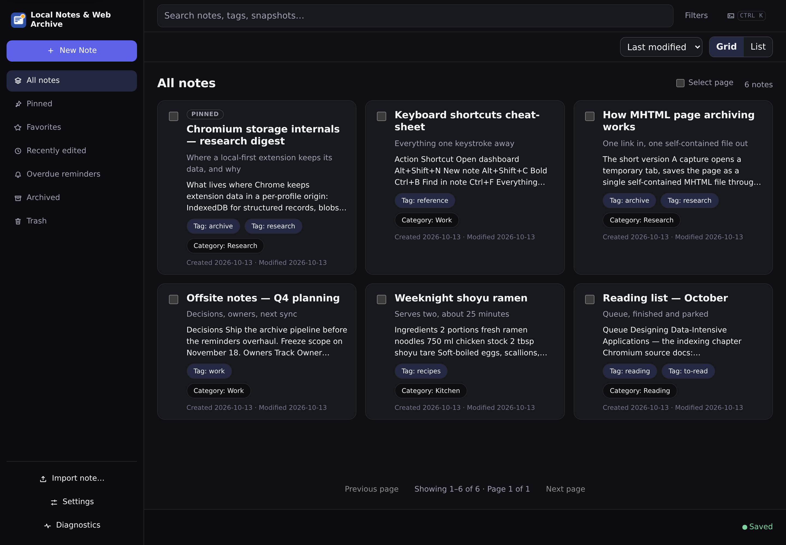
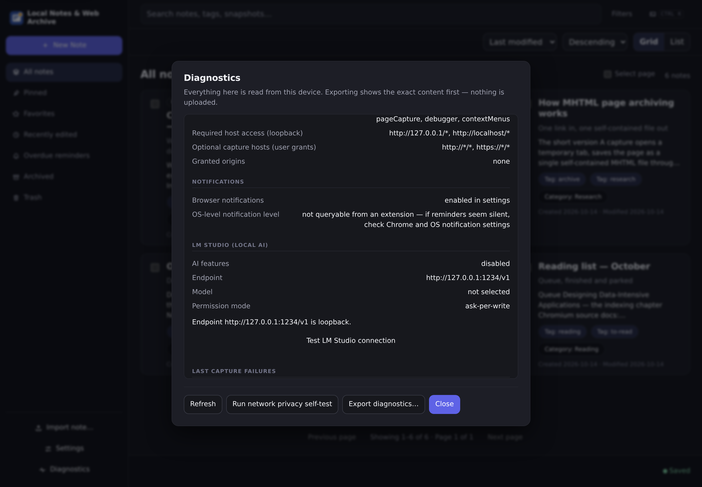

# Local Notes & Web Archive for Chrome



A local-first, offline-first **Chrome note-taking extension** with rich-text
notes, **MHTML web page archiving**, reminders and **optional local AI
(LM Studio)** — no cloud, no accounts, no telemetry, no remote code.
Everything stays on your device.

[](https://developer.chrome.com/docs/extensions)
[](https://developer.chrome.com/docs/extensions/reference/manifest)
[](./LICENSE)
[](#quality-and-verification)
[](#quality-and-verification)
[](./docs/REPOSITORY_AUDIT.md)
[](./PRIVACY.md)

The complete product specification is [`PRD.md`](./PRD.md) (v1.0, approved
architecture baseline). This repository contains the full production source,
tests, build tooling and the bundled third-party dependency inventory.

## Highlights

- **Your notes never leave the machine.** All data lives in your Chrome
  profile's extension storage (IndexedDB). There is no backend, no sync
  service and no analytics — the manifest's CSP allows `connect-src` to the
  extension itself and loopback only.
- **Archive web pages as single self-contained MHTML files** through Chrome's
  `pageCapture` API, with extracted searchable text and a best-effort
  full-page PNG — stored locally, exported to your filesystem on demand.
- **A real rich-text editor** (Tiptap/ProseMirror) with headings, tables,
  task lists, code blocks, images, attachments and Markdown import/export.
- **Fast offline full-text search** with a query syntax (`tag:`, `is:pinned`,
  `has:snapshot`, phrases, exclusions, date ranges) over notes and archived
  page text.
- **Optional local AI** that talks only to your own LM Studio endpoint on
  `127.0.0.1`/`localhost` — never a cloud fallback. Every model-proposed
  tool call is validated and permission-gated.

## Screenshots

Real screenshots of the released build, captured by the automated
screenshot suite ([`tests/e2e/screenshots.spec.ts`](./tests/e2e/screenshots.spec.ts))
from the live extension — the demo library was seeded through the real UI
(notes authored in the rich-text editor, tags and categories assigned
through the bulk bar, one note pinned).

| | |
|---|---|
|  |  |
|  |  |
|  |  |

Retina captures (2880 px wide); the social banner is 1280x640 for link previews.

## Install from the release (no build steps)

The published package is fully built and tested — nothing to compile:

1. Download `local-notes-web-archive-1.0.2.zip` from the
   [v1.0.2 release](https://github.com/kimpearce888/local-notes-web-archive/releases/tag/v1.0.2).
2. Extract the ZIP anywhere on your machine.
3. Open `chrome://extensions` and enable **Developer mode**.
4. Click **Load unpacked** and select the **extracted** folder.
5. Use the extension — the toolbar action opens the notes dashboard
   (Chrome 120+, everything stays on your device).

The release carries the SHA-256 checksum (`.sha256` asset) and a
byte-for-byte file inventory (`RELEASE_MANIFEST.txt`); the exact artifact
layout is what the automated extract-and-load acceptance suite verifies.

## Features

### Rich-text notes with structure

A WYSIWYG editor (headings, lists, tables, images, attachments, links, code
blocks with language labels, Markdown/HTML import-export), tags, nested
categories, pinning, favorites, archive, trash with restore, and revision
history. Autosave reaches a durable **Saved** state; recovery survives
browser crashes.

### Web page archiving (MHTML + PNG + extracted text)

Paste a link and capture the page: a self-contained MHTML archive via
Chrome's `pageCapture` API, extracted searchable text, and a best-effort
full-page PNG screenshot through the DevTools protocol. Everything is stored
locally in IndexedDB; MHTML is exported and opened from the filesystem,
never rendered inside the extension UI. Honest limits (paywalls, very tall
or script-heavy pages) are documented in
[`KNOWN_LIMITATIONS.md`](./KNOWN_LIMITATIONS.md).

### Fast, offline full-text search

Search notes and archived page text completely offline, with or without AI.
Prefix matching, phrases, exclusions, filters and saved views.

### Reminders that respect reality

One-time and yearly reminders with an inclusive final year, Feb-29 policies,
DST-safe local wall-clock scheduling, and honest limits (Chrome must be
running; nothing wakes a sleeping computer — missed occurrences are
coalesced and shown as overdue).

### Optional local AI (LM Studio)

Connects only to your own LM Studio local API on loopback. The model can
propose validated tool calls (search, summarize, tag, create/edit notes,
manage reminders); the application validates, authorizes and executes every
operation under your chosen permission mode. There is no cloud fallback,
ever. AI is off by default and every note feature works without it.

### Backups, diagnostics and data ownership

Full ZIP backup/restore (with preview, merge and replace modes), per-note
export (JSON, Markdown, sanitized HTML), per-snapshot export (MHTML, PNG,
text), a diagnostics page (versions, storage, index status, permissions, LM
Studio reachability, sanitized error log, audit trail, network privacy
self-test), and a first-run onboarding that tells the truth about local
storage and data-loss risk.

## Search syntax

| Query | Meaning |
|---|---|
| `storage internals` | notes matching both terms (prefix-aware) |
| `"exact phrase"` | phrase matching |
| `-draft` or `-"to read"` | exclude results matching a term or phrase |
| `tag:work tag:q4` | filter by tags (multiple allowed) |
| `category:projects` | filter by category |
| `is:pinned` `is:favorite` `is:archived` `is:trashed` `is:overdue` | state filters |
| `has:link` `has:snapshot` `has:reminder` `has:attachment` | content filters |
| `before:2026-01-01` / `after:2026-06-01` | created/modified date range (RFC3339) |
| `in:title chrom` | scope subsequent bare terms to title, body or snapshot text |

Invalid syntax produces an inline explanation — never a silent behavior
change.

## Privacy by architecture

- **No backend, no accounts, no telemetry, no analytics** — nothing to log
  in to and nothing phoning home ([`PRIVACY.md`](./PRIVACY.md) states the
  complete network surface).
- Exactly two kinds of network activity can ever happen: loading a page you
  explicitly asked to archive, and talking to your own LM Studio endpoint on
  loopback when AI is enabled. The CSP refuses everything else; a network
  privacy self-test in diagnostics re-verifies it.
- All user HTML (pasted, imported, AI-proposed) is sanitized before editor
  use; remote images are never fetched; `javascript:` links are rejected.
- Permission hygiene: every manifest permission is documented with its
  rationale and revocation path in [`PERMISSIONS.md`](./PERMISSIONS.md);
  site access for captures is granted per-origin and revocable.

## Quality and verification

| Gate | Result |
|---|---|
| Unit + integration tests (Vitest) | **762/762 passing** |
| End-to-end tests (Playwright, real Chromium, unpacked build) | **44/44 passing** |
| Performance budget (search p95 < 500 ms over 10,000 notes) | PASS |
| Secrets scan (worktree + full git history) | 0 findings |
| `npm audit` (production and full graphs) | 0 vulnerabilities |
| Static release gate (no remote URLs, no dynamic code) | PASS |
| Release artifact | checksummed, inventory-verified, GitHub Release cross-checked |

Details and reproduction commands: [`docs/REPOSITORY_AUDIT.md`](./docs/REPOSITORY_AUDIT.md)
(repositories audit) and [`docs/RELEASE_VERIFICATION.md`](./docs/RELEASE_VERIFICATION.md)
(release gate matrix, measured numbers, keyboard accessibility pass).

The E2E suite includes a dedicated human-simulation round (new/returning/
power/invalid/malicious personas, rapid clicking, XSS and `javascript:`
payloads, clipboard HTML sanitization, browser restart persistence) and a
ZIP extract-and-load acceptance test that treats the release package as the
product.

## Documentation

| Document | Contents |
|---|---|
| [`PRD.md`](./PRD.md) | Product requirements (source of truth) |
| [`PRIVACY.md`](./PRIVACY.md) | What is stored locally, what network calls exist |
| [`PERMISSIONS.md`](./PERMISSIONS.md) | Every manifest permission, why, how to revoke |
| [`KNOWN_LIMITATIONS.md`](./KNOWN_LIMITATIONS.md) | Honest limits: MCP, reminders, capture fidelity |
| [`BACKUP_RESTORE.md`](./BACKUP_RESTORE.md) | Backup format, validation, merge/replace, portability |
| [`SECURITY.md`](./SECURITY.md) | Threat model, reporting, sandboxing, update policy |
| [`THIRD_PARTY_NOTICES.md`](./THIRD_PARTY_NOTICES.md) | Licenses of every bundled runtime dependency |
| [`DEPENDENCIES.json`](./DEPENDENCIES.json) | Machine-readable pinned dependency inventory |
| [`docs/EXTENSION_IDENTITY.md`](./docs/EXTENSION_IDENTITY.md) | Stable extension ID and key management |
| [`docs/RELEASE_VERIFICATION.md`](./docs/RELEASE_VERIFICATION.md) | Release gate results, measured performance, keyboard pass, artifact checksums |
| [`docs/REPOSITORY_AUDIT.md`](./docs/REPOSITORY_AUDIT.md) | Full repository audit: structure, code metrics, secrets scan, npm audit, release integrity |

## FAQ

**Where is my data?**
In your Chrome profile's extension storage (IndexedDB) on this device.
Nothing is synchronized, replicated or uploaded anywhere. Back up before
uninstalling — removing the extension removes its storage
([`BACKUP_RESTORE.md`](./BACKUP_RESTORE.md)).

**Does it work offline?**
Yes — notes, search, reminders, export and backup all work with no network.
Archiving loads the page you asked to save; AI needs your local LM Studio.

**Does the AI send my notes anywhere?**
No. AI is off by default. When enabled, requests go only to the loopback
endpoint you configured, carrying the minimum context for the action you
invoked; audit events record tool name and outcome, never prompt or response
content. Model output is treated as untrusted proposals, validated and
permission-gated before execution.

**Why the `pageCapture` and `debugger` permissions?**
MHTML archiving and full-page PNG capture, used only on the single temporary
tab opened for a capture you explicitly requested. Full rationale and
revocation: [`PERMISSIONS.md`](./PERMISSIONS.md).

**How do I update?**
Replace the files inside the same folder and press **Reload** on
`chrome://extensions`. Do not uninstall/reinstall for routine updates — the
extension keeps a stable ID and storage origin for the same folder path.

**Will reminders fire while my computer is off?**
No — and the extension says so instead of pretending. Reminders fire while
Chrome runs; missed occurrences are reconciled and shown as overdue on
startup ([`KNOWN_LIMITATIONS.md`](./KNOWN_LIMITATIONS.md)).

**Which browsers are supported?**
Desktop Google Chrome 120 or newer (or a compatible Chromium distribution
tested at the same version). Nothing else is required — no Node.js, no
server, no database, no Docker at runtime.

## Development from source

```bash
npm install        # installs exact pinned dependencies (package-lock.json)
npm run lint       # eslint
npm run check      # tsc --noEmit (strict)
npm test           # vitest unit tests
npm run build      # vite build -> dist/ (the loadable extension folder)
npm run release    # dist/ + versioned zip + SHA-256 checksums
npm run test:e2e   # Playwright suite (loads dist/ unpacked, real Chromium)
```

A dev/test-only `Dockerfile.test` + `docker-compose.yml` reproduce the lint/
typecheck/unit-test environment. Docker is **never** used at runtime or for
installation (PRD §1, §7).

## License & third-party components

First-party code: **MIT** ([LICENSE](./LICENSE)). All bundled runtime
dependencies are free/open-source, pinned and vendored into the release folder:
[`THIRD_PARTY_NOTICES.md`](./THIRD_PARTY_NOTICES.md) and
[`DEPENDENCIES.json`](./DEPENDENCIES.json). LM Studio (optional AI runtime) is
external, proprietary, user-installed software — never bundled or required.

## Status

Implementation is complete against the PRD: every feature area (notes,
search, capture, reminders, local AI, data lifecycle, observability,
settings/onboarding) is implemented, tested and verified by the release
gate. See [`ai/plan.md`](./ai/plan.md) and [`ai/completed.md`](./ai/completed.md)
for the task-level record.
